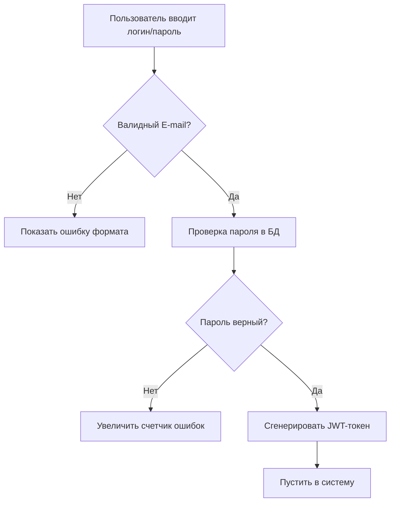

    %% Несколько стрелок ИЗ одного элемента
    Start[Пользователь нажал кнопку] --> Auth[Авторизоваться]
    Start --> Guest[Войти как гость]
    Start --> Info[Открыть справку]

    %% Несколько стрелок В один элемент
    Auth --> Dashboard[Главный экран]
    Guest --> Dashboard
```
